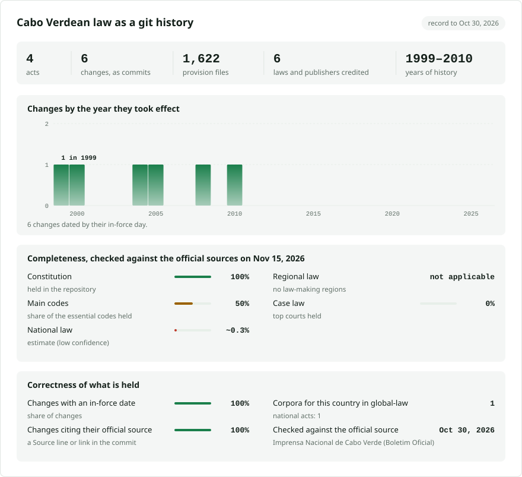

# Cabo Verde: law history in git

[Português](README.md) · **English**

<picture>
<source media="(prefers-color-scheme: dark)" srcset="data/effort-dark.svg">

</picture>

The law of Cabo Verde as a git history: one file per article, one commit per version on the day it took effect, and the act that made each change as the commit's author. `git blame` names the act behind every paragraph; `git log` lists every change to an article; picking a date gives the text in force that day.

Part of [lexifina/global-law](https://github.com/lexifina/global-law), one git history for every country's law: this is Cabo Verde's national law, which global-law reads at `cabo-verde/national/acts/`.

**What is in it now:** the Constitution (Constituição da República de Cabo Verde) in three versions, of 1999, 2000 and 2010, with its preamble, its 295 articles, the closing signature and the annex (the national anthem); three codes, each in one version, as enacted, with the decree that approved it: the Código Penal (2003, 380 articles), the Código de Processo Penal (2005, 487 articles) and the Código Laboral (2007, 416 articles), in `codigos/` (also `codigos/codigo-maritimo/`). And, as published in the Boletim Oficial (1990–2025), 50 decree-laws, 33 resolutions, 26 portarias, 22 regulatory decrees, 9 decrees, 9 laws, 2 international agreements and 2 legislative decrees, each in `<type>/<year>/<number>-<subject>/`. Each act's folder has a `README.md` listing its provisions; the layout is in [STRUCTURE.md](STRUCTURE.md).

Each act is a folder, one file per article: `codigos/codigo-laboral/art-052.md` is Article 52 (Período de férias) of the Código Laboral, and the approving decree's own articles are `dl-art-NNN.md`. The Constitution's headings (partes, títulos, capítulos, secções) are gathered in [`constituicao/estrutura.md`](constituicao/estrutura.md). The 2010 revision renumbered the Constitution, so after 3 May 2010 a file holds the article that now bears its number.

The text is in Portuguese, as the Boletim Oficial and the Ministério da Justiça's editions print it. An English translation is not part of this record.

## Questions as git commands

| Question | Command |
| --- | --- |
| Every change to Article 52 of the Código Laboral (annual leave) | `git log -p --word-diff -- codigos/codigo-laboral/art-052.md` |
| Which act wrote each paragraph of Article 52? | `git blame codigos/codigo-laboral/art-052.md` |
| Every version of Article 52, with the day each took effect | `git log --format="%h %(trailers:key=In-force,valueonly,separator=) %an" -- codigos/codigo-laboral/art-052.md` |
| Article 52 as in force on 1 January 2009 | `python tools/vigente_em.py 2009-01-01 codigos/codigo-laboral 52` |

**Outside git**, we also host this record publicly, for free:

- **[Ask Claude about Cabo Verdean law](https://global-law.lexifina.com/v1/try_claude?country=cabo-verde)**: opens Claude with a first question ready.
- **[Ask ChatGPT](https://global-law.lexifina.com/v1/try_chatgpt?country=cabo-verde)**: the same question in ChatGPT.
- **[Search Cabo Verdean law on our site](https://lexifina.com/law?country=cabo-verde&q=f%C3%A9rias)**: a search for "férias" (annual leave), with each provision's text and its versions, no account needed.
- **[Developer REST API](https://global-law.lexifina.com/v1/search_law?query=f%C3%A9rias&jurisdiction=cabo-verde)**: the same search as JSON, with no key. See the [documentation here](https://lexifina.com/api/global-law).

Both assistants read the record through the free Global law connector (MCP, `https://global-law.lexifina.com/mcp`); the first time, the chat gives you the link that adds it. Ask in Portuguese or in English.

**Host it yourself easily.** All it takes is git and Python, and the tools run on your machine:

```sh
git clone --depth 1 https://github.com/lexifina/global-law && cd global-law
python3 tools/countries.py add cabo-verde/national/acts
python3 tools/law.py show 2009-01-01 cabo-verde/national/acts/codigos/codigo-laboral/art-052.md
```

Opened in Claude Code, Cursor, VS Code or Codex, the clone also starts a local MCP server with the same tools ([MCP.md](https://github.com/lexifina/global-law/blob/main/MCP.md)).

## Dates

Each commit is dated at noon, Atlantic/Cape_Verde, on the day the version took effect, and carries it in its `In-force:` trailer:

- the day comes from the in-force clause of the act that made the version: the Constitution on the day of its republication (Lei Constitucional nº 1/V/99, art. 185, "immediately": 23 November 1999; Lei Constitucional nº 1/VII/2010, art. 6, on publication: 3 May 2010), the Código Penal on 1 July 2004 and the Código de Processo Penal on 1 October 2005 (their decrees' arts. 10 and 5), and the Código Laboral 180 days after its publication on 16 October 2007, counted from the next day: 13 April 2008;
- the rectifications of 14 February 2000 and 26 July 2010 are dated on their publication, though a rectification is read as the text of the original publication;
- `tools/vigente_em.py` picks the version by that trailer, not by the commit date.

The first version of the Constitution is credited to the publisher, the Imprensa Nacional de Cabo Verde, as the oldest version available, and its commit names the laws that produced the text; each later change is credited to the law that made it, and Lei Constitucional nº 1/VII/2010 to every article that differs in 2010, renumbering included. Each code is credited whole to the decree that approved it. The committer is always Lexifina.

## How it is checked

- `tools/check_repo.py` reads every version back from git on the day it took effect and on the day before, and both must match the corpus: 6 versions of 4 acts, 0 mismatches. A second build from the same corpus gave identical hashes. The results are in [`REPRODUCE.md`](REPRODUCE.md).
- The texts are read from the PDFs' own text layers, not scans. Every article of the 1999 and 2010 Constitution was compared, character for character, with a second, independent extraction of the same PDFs, and every paragraph of the three codes was found, in order, in one; each of the three corrections of 2000 must be found in the rectification's own text.
- The 2010 text was compared word for word with the Assembleia Nacional's 4th edition of the Constitution (see below).
- History is append-only: no merge commits, no commit dated in the future, and every commit's trailers parse.
- [vulnerabilities/](vulnerabilities/README.en.md): possible drafting mistakes in this law, found by global-law's detectors and checked by hand. Not run yet.

## What it does not show

- **Today's text of the codes.** Each is the text as enacted. Not applied: Decreto-Legislativo nº 5/2010, Decreto-Legislativo nº 1/2016 and Lei nº 32/X/2023 (Código Laboral); Decreto-Legislativo nº 4/2015, Lei nº 117/IX/2021, Lei nº 18/X/2023 and others (Código Penal); Decreto-Legislativo nº 5/2015, which revised and republished the Código de Processo Penal, and later laws.
- **The Constitution before 1999.** The texts of 1992 (Lei Constitucional nº 1/IV/92) and 1995 (nº 1/IV/95) are published only as scanned images, which this record does not transcribe.
- **The Assembleia Nacional edition's wording of art. 168.** The rectification of 26 July 2010 (Boletim Oficial, I Série, nº 28, on the Assembleia Nacional's Legislação page) is applied from that day (arts. 88, 91, 181, 203, 226 and 278 and the words of the anthem); art. 168 still reads differently in the Assembleia Nacional's edition, which no published rectification explains, and the record keeps the Boletim's wording.
- **Other acts**, such as the Código Civil, the Código das Empresas Comerciais and the data protection law; and no case law or local acts.
- **Headings, printing errors, the anthem's score.** Headings are not in the article files (the codes have no structure file); printing errors are kept as printed; the score, an image, is left out.

## Sources

| Source | Kind | Past versions | Notes |
| --- | --- | --- | --- |
| [Tribunal Constitucional](https://www.tribunalconstitucional.cv/index.php/leis-constitucionais/): Leis Constitucionais | Official journal: Boletim Oficial PDFs (Imprensa Nacional de Cabo Verde) | yes, each constitutional law as published | The 1999, 2000 and 2010 texts; those of 1992 and 1995 are scans |
| Suplemento ao Boletim Oficial, I Série, nº 37, 16 October 2007, copy held by [FAOLEX](https://faolex.fao.org/docs/pdf/cvi221870original.pdf) | Official journal | no, as enacted | Decreto-Legislativo nº 5/2007 and the Código Laboral |
| Ministério da Justiça, official editions of the [Código Penal](https://sherloc.unodc.org/cld/uploads/res/document/cpv/2003/codigo_penal_html/Codigo_Penal_Cabo_Verde.pdf) (2004) and the [Código de Processo Penal](https://sherloc.unodc.org/cld/uploads/res/document/cdigo-de-processo-penal-de-cabo-verde_html/Cabo_Verde_Code_of_Criminal_Procedure_in_Portuguese.pdf) (2005), copies held by UNODC SHERLOC | Official editions | no, as enacted | Decretos-Legislativos nº 4/2003 and nº 2/2005 and the codes they approve |
| Assembleia Nacional: Constituição da República, 4th edition (2010), published by the [Comissão Nacional de Protecção de Dados](https://www.cnpd.cv/legislacao/) | Official edition | no | A word-for-word cross-check only |

## Licence

See [`LICENSE`](LICENSE). The texts are official legislative texts of Cabo Verde, reproduced with attribution to the Boletim Oficial (Imprensa Nacional de Cabo Verde), the Ministério da Justiça and the sites holding the copies; the Tribunal Constitucional's site publishes no licence for them, and their copyright status is not confirmed. The history, commit messages, tables and tools are CC0 1.0.

No AI model wrote, translated or corrected legal text, and none runs when the history is built; the scripts were written by an AI model (see [`REPRODUCE.md`](REPRODUCE.md)).

## Visualisations

- [visualisations/](visualisations/README.en.md): charts drawn from this repository. Not drawn yet.

## More

From [lexifina/global-law](https://github.com/lexifina/global-law):

- [FEATURES.md](https://github.com/lexifina/global-law/blob/main/FEATURES.md): every feature, and what every corpus must support (`git blame`, `law.py`, the MCP tools)
- [FAQ.md](https://github.com/lexifina/global-law/blob/main/FAQ.md): questions and answers · [CONTRIBUTING.md](https://github.com/lexifina/global-law/blob/main/CONTRIBUTING.md): proposing changes · [MCP.md](https://github.com/lexifina/global-law/blob/main/MCP.md): the MCP server · [REPRODUCE.md](https://github.com/lexifina/global-law/blob/main/REPRODUCE.md): how it was built · [CHANGELOG.md](https://github.com/lexifina/global-law/blob/main/CHANGELOG.md)
- [FRESHNESS.md](https://github.com/lexifina/global-law/blob/main/FRESHNESS.md): how current each corpus is · [Monitoring](https://github.com/lexifina/global-law/tree/main/monitoring): whether updates are running · [WATCHING.md](https://github.com/lexifina/global-law/blob/main/WATCHING.md): how each official source is watched for changes
- [performance/](https://github.com/lexifina/global-law/tree/main/performance): how fast the tools are, measured
- [visualisations/](https://github.com/lexifina/global-law/tree/main/visualisations): charts and bridges across the world's law
- [Vulnerabilities](https://github.com/lexifina/global-law/tree/main/vulnerabilities): mistakes in legislation as published
