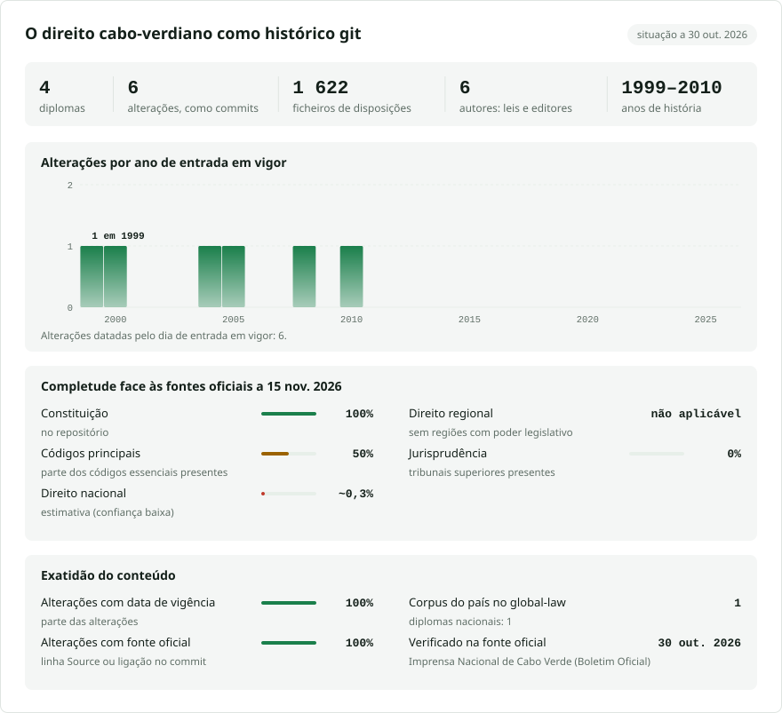

# Cabo Verde: a história do direito em git

**Português** · [English](README.en.md)

<picture>
<source media="(prefers-color-scheme: dark)" srcset="data/pt/effort-dark.svg">

</picture>

O direito de Cabo Verde como uma história git: um ficheiro por artigo, um commit por versão no dia em que entrou em vigor e, como autor do commit, o ato que fez cada alteração. `git blame` indica o ato por detrás de cada parágrafo; `git log` lista todas as alterações a um artigo; escolhendo uma data, obtém-se o texto em vigor nesse dia.

Faz parte de [lexifina/global-law](https://github.com/lexifina/global-law), uma única história git do direito de todos os países: este é o direito nacional de Cabo Verde, que o global-law lê em `cabo-verde/national/acts/`.

**O que contém por agora:** a Constituição (Constituição da República de Cabo Verde) em três versões, de 1999, 2000 e 2010, com o preâmbulo, os 295 artigos, a assinatura final e o anexo (o hino nacional); três códigos, cada um numa só versão, tal como aprovado, com o decreto que o aprovou: o Código Penal (2003, 380 artigos), o Código de Processo Penal (2005, 487 artigos) e o Código Laboral (2007, 416 artigos), em `codigos/` (e ainda `codigos/codigo-maritimo/`, `codigos/codigo-maritimo-28-2016/`). E, tal como publicados no Boletim Oficial (1983–2026), 252 resoluções, 244 decretos-leis, 110 portarias, 62 decretos-regulamentares, 58 leis, 39 decretos, 14 decretos-legislativos, 6 acordos internacionais, 2 avisos, 2 decretos presidenciais e 1 despacho, cada um em `<tipo>/<ano>/<número>-<objecto>/`. A pasta de cada ato tem um `README.md` que lista as suas disposições; a organização está em [STRUCTURE.md](STRUCTURE.md).

Cada ato é uma pasta, com um ficheiro por artigo: `codigos/codigo-laboral/art-052.md` é o artigo 52 (Período de férias) do Código Laboral, e os artigos do próprio decreto de aprovação são `dl-art-NNN.md`. As divisões da Constituição (partes, títulos, capítulos, secções) estão reunidas em [`constituicao/estrutura.md`](constituicao/estrutura.md). A revisão de 2010 renumerou a Constituição, pelo que, a partir de 3 de maio de 2010, cada ficheiro contém o artigo que passou a ter esse número.

O texto está em português, tal como o Boletim Oficial e as edições do Ministério da Justiça o publicam. Não faz parte deste registo nenhuma tradução inglesa.

## Perguntas como comandos git

| Pergunta | Comando |
| --- | --- |
| Todas as alterações ao artigo 52 do Código Laboral (férias) | `git log -p --word-diff -- codigos/codigo-laboral/art-052.md` |
| Que ato escreveu cada parágrafo do artigo 52? | `git blame codigos/codigo-laboral/art-052.md` |
| Todas as versões do artigo 52, com o dia em que cada uma entrou em vigor | `git log --format="%h %(trailers:key=In-force,valueonly,separator=) %an" -- codigos/codigo-laboral/art-052.md` |
| O artigo 52 em vigor em 1 de janeiro de 2009 | `python tools/vigente_em.py 2009-01-01 codigos/codigo-laboral 52` |

**Fora do git**, também disponibilizamos este registo publicamente e de forma gratuita:

- **[Perguntar ao Claude sobre o direito cabo-verdiano](https://global-law.lexifina.com/v1/try_claude?country=cabo-verde)**: abre o Claude com uma primeira pergunta já preparada.
- **[Perguntar ao ChatGPT](https://global-law.lexifina.com/v1/try_chatgpt?country=cabo-verde)**: a mesma pergunta no ChatGPT.
- **[Pesquisar o direito cabo-verdiano no nosso sítio](https://lexifina.com/law?country=cabo-verde&q=f%C3%A9rias)**: uma pesquisa por "férias", com o texto de cada disposição e as suas versões, sem necessidade de conta.
- **[API REST para programadores](https://global-law.lexifina.com/v1/search_law?query=f%C3%A9rias&jurisdiction=cabo-verde)**: a mesma pesquisa em JSON, sem chave. Veja a [documentação aqui](https://lexifina.com/api/global-law).

Ambos os assistentes leem o registo através do conector gratuito Global law (MCP, `https://global-law.lexifina.com/mcp`); da primeira vez, a conversa dá-lhe a ligação que o adiciona. Pergunte em português ou em inglês.

**Aloje-o facilmente por conta própria.** Basta ter git e Python, e as ferramentas correm na sua máquina:

```sh
git clone --depth 1 https://github.com/lexifina/global-law && cd global-law
python3 tools/countries.py add cabo-verde/national/acts
python3 tools/law.py show 2009-01-01 cabo-verde/national/acts/codigos/codigo-laboral/art-052.md
```

Aberto no Claude Code, no Cursor, no VS Code ou no Codex, o clone inicia também um servidor MCP local com as mesmas ferramentas ([MCP.md](https://github.com/lexifina/global-law/blob/main/MCP.md)).

## Datas

Cada commit tem a data do meio-dia, hora de Atlantic/Cape_Verde, do dia em que a versão entrou em vigor, e indica-a no seu trailer `In-force:`:

- o dia resulta da norma de entrada em vigor do ato que fez a versão: a Constituição no dia da sua republicação (Lei Constitucional nº 1/V/99, art. 185, "imediatamente": 23 de novembro de 1999; Lei Constitucional nº 1/VII/2010, art. 6, na data da publicação: 3 de maio de 2010), o Código Penal em 1 de julho de 2004 e o Código de Processo Penal em 1 de outubro de 2005 (arts. 10 e 5 dos respetivos decretos), e o Código Laboral 180 dias após a sua publicação em 16 de outubro de 2007, contados a partir do dia seguinte: 13 de abril de 2008;
- as retificações de 14 de fevereiro de 2000 e de 26 de julho de 2010 têm a data da sua publicação, embora uma retificação se leia como texto da publicação original;
- `tools/vigente_em.py` escolhe a versão por esse trailer, e não pela data do commit.

A primeira versão da Constituição é atribuída ao editor, a Imprensa Nacional de Cabo Verde, como a versão mais antiga disponível, e o seu commit indica as leis que produziram o texto; cada alteração posterior é atribuída à lei que a fez, e a Lei Constitucional nº 1/VII/2010 a todos os artigos que diferem em 2010, incluindo a renumeração. Cada código é atribuído por inteiro ao decreto que o aprovou. O committer é sempre a Lexifina.

## Como é verificado

- `tools/check_repo.py` relê a partir do git cada versão no dia em que entrou em vigor e no dia anterior, e ambas têm de coincidir com o corpus: 6 versões de 4 atos, 0 divergências. Uma segunda construção a partir do mesmo corpus deu hashes idênticos. Os resultados estão em [`REPRODUCE.md`](REPRODUCE.md).
- Os textos são lidos das próprias camadas de texto dos PDF, não de digitalizações. Cada artigo da Constituição de 1999 e de 2010 foi comparado, carácter a carácter, com uma segunda extração independente dos mesmos PDF, e cada parágrafo dos três códigos foi encontrado, pela ordem, numa delas; cada uma das três correções de 2000 tem de constar do próprio texto da retificação.
- O texto de 2010 foi comparado palavra a palavra com a 4.ª edição da Constituição da Assembleia Nacional (ver abaixo).
- A história só cresce por acréscimo: sem commits de fusão (merge), sem nenhum commit com data futura, e os trailers de todos os commits são legíveis.
- [vulnerabilities/](vulnerabilities/): possíveis erros de redação neste direito, encontrados pelos detetores do global-law e verificados à mão. Ainda não executado.

## O que não mostra

- **O texto atual dos códigos.** Cada um é o texto tal como aprovado. Não estão aplicados: o Decreto-Legislativo nº 5/2010, o Decreto-Legislativo nº 1/2016 e a Lei nº 32/X/2023 (Código Laboral); o Decreto-Legislativo nº 4/2015, a Lei nº 117/IX/2021, a Lei nº 18/X/2023 e outros (Código Penal); o Decreto-Legislativo nº 5/2015, que reviu e republicou o Código de Processo Penal, e leis posteriores.
- **A Constituição anterior a 1999.** Os textos de 1992 (Lei Constitucional nº 1/IV/92) e de 1995 (nº 1/IV/95) só estão publicados como imagens digitalizadas, que este registo não transcreve.
- **A redação do art. 168 da edição da Assembleia Nacional.** A retificação de 26 de julho de 2010 (Boletim Oficial, I Série, nº 28, na página Legislação da Assembleia Nacional) está aplicada desde esse dia (arts. 88, 91, 181, 203, 226 e 278 e a letra do hino); o art. 168 tem ainda outra redação na edição da Assembleia Nacional, que nenhuma retificação publicada explica, e o registo mantém a redação do Boletim.
- **Outros atos**, como o Código Civil, o Código das Empresas Comerciais e a lei de proteção de dados; e nenhuma jurisprudência nem atos locais.
- **Epígrafes, gralhas de impressão, a partitura do hino.** As epígrafes não estão nos ficheiros dos artigos (os códigos não têm ficheiro de estrutura); as gralhas de impressão mantêm-se tal como impressas; a partitura, uma imagem, fica de fora.

## Fontes

| Fonte | Tipo | Versões anteriores | Notas |
| --- | --- | --- | --- |
| [Tribunal Constitucional](https://www.tribunalconstitucional.cv/index.php/leis-constitucionais/): Leis Constitucionais | Jornal oficial: PDF do Boletim Oficial (Imprensa Nacional de Cabo Verde) | sim, cada lei constitucional tal como publicada | Os textos de 1999, 2000 e 2010; os de 1992 e 1995 são digitalizações |
| Suplemento ao Boletim Oficial, I Série, nº 37, de 16 de outubro de 2007, cópia conservada pela [FAOLEX](https://faolex.fao.org/docs/pdf/cvi221870original.pdf) | Jornal oficial | não, tal como aprovado | O Decreto-Legislativo nº 5/2007 e o Código Laboral |
| Ministério da Justiça, edições oficiais do [Código Penal](https://sherloc.unodc.org/cld/uploads/res/document/cpv/2003/codigo_penal_html/Codigo_Penal_Cabo_Verde.pdf) (2004) e do [Código de Processo Penal](https://sherloc.unodc.org/cld/uploads/res/document/cdigo-de-processo-penal-de-cabo-verde_html/Cabo_Verde_Code_of_Criminal_Procedure_in_Portuguese.pdf) (2005), cópias conservadas pelo UNODC SHERLOC | Edições oficiais | não, tal como aprovado | Os Decretos-Legislativos nº 4/2003 e nº 2/2005 e os códigos que aprovam |
| Assembleia Nacional: Constituição da República, 4.ª edição (2010), publicada pela [Comissão Nacional de Protecção de Dados](https://www.cnpd.cv/legislacao/) | Edição oficial | não | Apenas uma verificação cruzada palavra a palavra |

## Licença

Veja [`LICENSE`](LICENSE). Os textos são textos legislativos oficiais de Cabo Verde, reproduzidos com atribuição ao Boletim Oficial (Imprensa Nacional de Cabo Verde), ao Ministério da Justiça e aos sítios que conservam as cópias; o sítio do Tribunal Constitucional não publica nenhuma licença para eles, e o seu estatuto quanto ao direito de autor não está confirmado. A história, as mensagens de commit, as tabelas e as ferramentas estão sob CC0 1.0.

Nenhum modelo de IA escreveu, traduziu ou corrigiu texto jurídico, e nenhum é executado quando a história é construída; os scripts foram escritos por um modelo de IA (veja [`REPRODUCE.md`](REPRODUCE.md)).

Esta é uma tradução da versão inglesa ([README.en.md](README.en.md)); em caso de divergência, prevalece a versão inglesa.

## Visualizações

- [visualisations/](visualisations/): gráficos feitos a partir deste repositório. Ainda não feitos.

## Mais informação

Do repositório [lexifina/global-law](https://github.com/lexifina/global-law) (páginas em inglês):

- [FEATURES.md](https://github.com/lexifina/global-law/blob/main/FEATURES.md): todas as funcionalidades e o que cada corpus tem de suportar (`git blame`, `law.py`, ferramentas MCP)
- [FAQ.md](https://github.com/lexifina/global-law/blob/main/FAQ.md): perguntas e respostas · [CONTRIBUTING.md](https://github.com/lexifina/global-law/blob/main/CONTRIBUTING.md): propor alterações · [MCP.md](https://github.com/lexifina/global-law/blob/main/MCP.md): servidor MCP · [REPRODUCE.md](https://github.com/lexifina/global-law/blob/main/REPRODUCE.md): como foi construído · [CHANGELOG.md](https://github.com/lexifina/global-law/blob/main/CHANGELOG.md)
- [FRESHNESS.md](https://github.com/lexifina/global-law/blob/main/FRESHNESS.md): quão atualizado está cada corpus · [Monitorização](https://github.com/lexifina/global-law/tree/main/monitoring): se as atualizações estão a funcionar · [WATCHING.md](https://github.com/lexifina/global-law/blob/main/WATCHING.md): como cada fonte oficial é vigiada para detetar alterações
- [performance/](https://github.com/lexifina/global-law/tree/main/performance): a rapidez das ferramentas, medida
- [visualisations/](https://github.com/lexifina/global-law/tree/main/visualisations): gráficos e ligações através do direito de todo o mundo
- [Vulnerabilidades](https://github.com/lexifina/global-law/tree/main/vulnerabilities): erros nos diplomas tal como foram publicados
